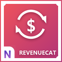
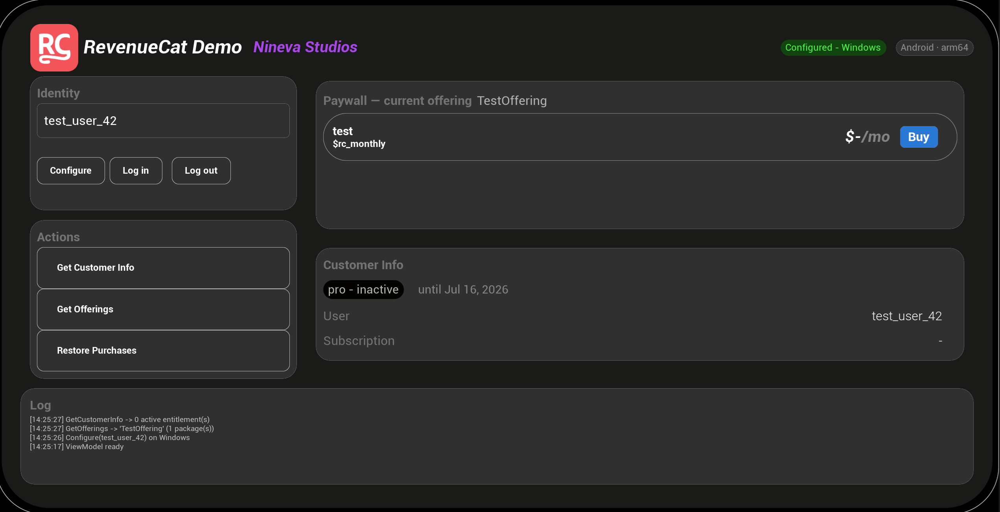
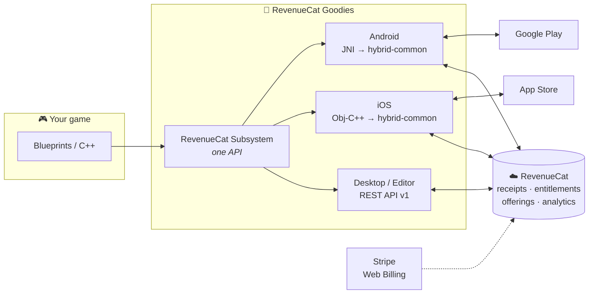
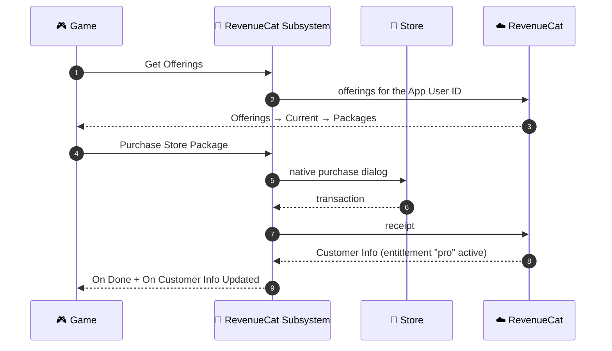
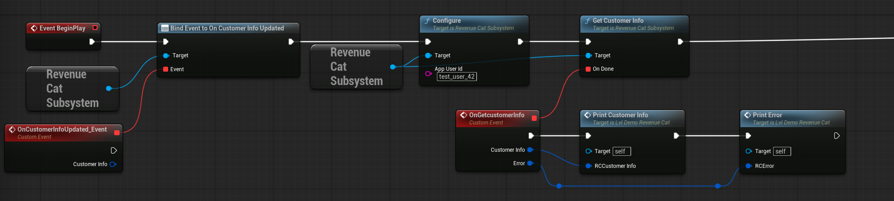
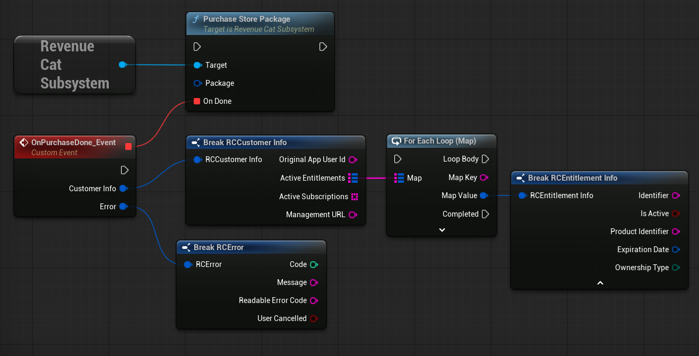
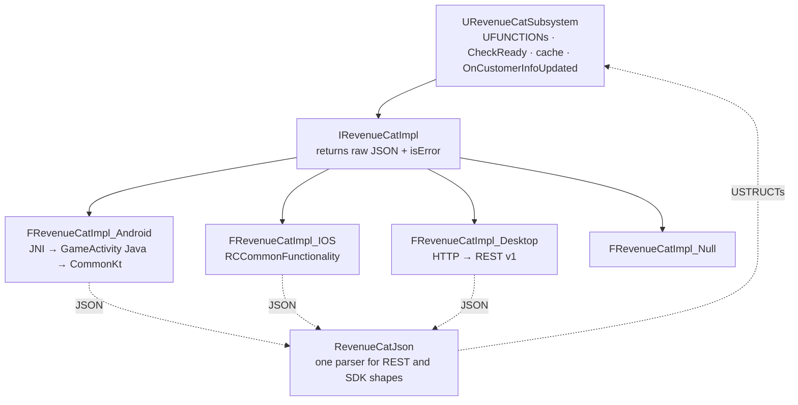

<div align="center">



# RevenueCat Goodies for Unreal Engine

**In-app purchases and subscriptions for Android, iOS and PC - one Blueprint & C++ API, powered by [RevenueCat](https://www.revenuecat.com/).**

[](https://www.unrealengine.com/)
[](#-changelog)
[](#-platform-support)
[](#-api-at-a-glance)
[](https://docs.ninevastudios.com/#/ue-plugins/revenuecat-unreal)
[](https://bit.ly/nineva_support_discord)

[**Documentation**](https://docs.ninevastudios.com/#/ue-plugins/revenuecat-unreal) ·
[**Quick start**](#-quick-start) ·
[**API**](#-api-at-a-glance) ·
[**Demo**](#-demo) ·
[**Support**](#-support)

<br>



</div>

---

## 📖 Contents

- [Why RevenueCat Goodies](#-why-revenuecat-goodies)
- [Platform support](#-platform-support)
- [How it works](#-how-it-works)
- [Quick start](#-quick-start)
- [API at a glance](#-api-at-a-glance)
- [Project Settings](#-project-settings)
- [Platform setup](#-platform-setup)
- [Demo](#-demo)
- [Testing](#-testing)
- [Error codes](#-error-codes)
- [Security](#-security)
- [Repository layout](#-repository-layout)
- [For contributors](#-for-contributors)
- [Changelog](#-changelog)
- [Support](#-support)

---

## ✨ Why RevenueCat Goodies

Store APIs are different on every platform, and validating receipts and tracking subscriptions by yourself is hard. [RevenueCat](https://www.revenuecat.com/) does that work on its servers. This plugin brings RevenueCat to Unreal Engine with **one API for all platforms**.

| | |
| --- | --- |
| 🧩 **One API, every store** | The same nodes work with Google Play, the App Store and Stripe (Web Billing). No per-platform code. |
| 🎟️ **Entitlements, not receipts** | RevenueCat validates every purchase. Your game only asks: *is `pro` active?* |
| 🛒 **Remote paywalls** | Offerings come from the RevenueCat dashboard. Change products and prices without a game update. |
| 🔄 **Cross-platform access** | Buy on Android, play on PC: one App User ID unlocks the same entitlements everywhere. |
| 🖥️ **PC out of the box** | Desktop builds and the Editor use the RevenueCat REST API and a Web Billing checkout in the browser. |
| 🧱 **Official SDKs inside** | Android and iOS run on RevenueCat's own [purchases-hybrid-common](https://github.com/RevenueCat/purchases-hybrid-common) - the layer the Unity, Flutter and React Native SDKs use. |
| 🧑‍🎨 **Blueprint-first, C++-friendly** | A Game Instance Subsystem with async nodes. All callbacks arrive on the Game Thread. |
| 🎮 **Ready-made demo** | A demo level with a complete paywall UI built on UE's MVVM - copy it and restyle it. |
| ✅ **Tested core** | 11 automation tests cover the JSON layer: active, expired, lifetime and grace-period entitlements, offerings, errors. |

---

## 🧩 Platform support

| Platform | Under the hood | How the player pays | Native version |
| --- | --- | --- | --- |
| **Android** | purchases-hybrid-common via JNI | Google Play purchase dialog | hybrid-common `18.15.1` → purchases-android `10.9.1` |
| **iOS** | purchases-hybrid-common via Objective-C++ | App Store payment sheet | hybrid-common `18.15.1` → purchases-ios `5.78.0` |
| **Windows · Mac · Linux** | RevenueCat REST API v1 | Web Billing checkout in the browser | - |
| **Editor (PIE)** | Same as desktop | Web Billing checkout in the browser | - |

**Requirements:** Unreal Engine **5.6**.
Android: `arm64` device, Minimum SDK **24**. iOS: a Mac with Xcode 15.2-16.x, iOS **15+**.

> [!NOTE]
> The iOS branch is code-complete and is being verified on devices. The checklist is in [`IOS_BUILD_NOTES.md`](IOS_BUILD_NOTES.md).

---

## 🧭 How it works



The store only takes the payment. **RevenueCat** receives every transaction, validates it and decides what the player has access to. The plugin asks RevenueCat for this state and hands it to your game as simple structures.

### A purchase, step by step



> [!TIP]
> **On desktop**, step 5 opens the Web Purchase Link in the browser. The player pays on the RevenueCat checkout page, and the plugin checks RevenueCat every 3 seconds until the new entitlement appears.

### Key terms

| Term | What it is | Example |
| --- | --- | --- |
| **Product** | An item you sell, created in a store | `pro_monthly` in Google Play Console |
| **Entitlement** | The access a purchase unlocks. **Check entitlements, not products** | `pro`, `no_ads` |
| **Offering** | A remotely configured set of packages for your paywall. One is *Current* | `default` |
| **Package** | One option of an offering, with the matching product for each store | `$rc_monthly`, `$rc_annual` |
| **App User ID** | Who the player is in RevenueCat: anonymous or your own account ID | `$RCAnonymousID:…`, `user_8c1f…` |
| **Customer Info** | What the player owns right now | active entitlements and subscriptions |

---

## 🚀 Quick start

You can try everything in **5 minutes** with RevenueCat's **Test Store**. You don't need any store accounts for it.

### 1. Install

1. Copy the `RevenueCat` folder to `<YourProject>/Plugins/`.
2. Enable **RevenueCat Goodies** in `Edit` → `Plugins`. It also enables UE's **Model View ViewModel** plugin, which the demo UI uses.
3. C++ projects only: add the module to your `.Build.cs`:

```csharp
PublicDependencyModuleNames.Add("RevenueCat");
```

### 2. Prepare the RevenueCat dashboard

1. Create a project at [app.revenuecat.com](https://app.revenuecat.com/).
2. **Product catalog → Entitlements**: create `pro` and attach a Test Store product to it.
3. **Product catalog → Offerings**: create an offering with a `$rc_monthly` package that contains this product. Make the offering the current one.
4. **API keys → SDK API keys**: copy the **Test Store** key (it starts with `test_`).

> [!CAUTION]
> Never use a key from the **Secret API keys** table (`sk_…`) in the game. Secret keys give full access to your project and can be extracted from any build.

### 3. Paste the key

Go to `Project Settings` → `Plugins` → `RevenueCat` and paste the key into **Web Billing Api Key** (Editor and desktop) and/or **Google Api Key** (Android).

### 4. Run the demo

Enable `Settings` → `Show Plugin Content` in the Content Browser, open **`RevenueCat Content/Demo/Maps/Lvl_Demo_RevenueCat`** and press **Play**. Then click **Configure** → **Get Offerings** → **Buy**.

### 5. Write your own code

<table>
<tr>
<td width="50%" valign="top">

**Blueprint**

On start: bind `On Customer Info Updated`, call `Configure` and `Get Customer Info`.



Purchase a package from `Get Offerings` and check the entitlement:



</td>
<td width="50%" valign="top">

**C++**

```cpp
#include "RevenueCatSubsystem.h"

void UMyGameInstance::Init()
{
    Super::Init();

    URevenueCatSubsystem* RC =
        GetSubsystem<URevenueCatSubsystem>();

    RC->OnCustomerInfoUpdated.AddDynamic(
        this, &UMyGameInstance::OnCustomerInfo);

    RC->Configure(TEXT("")); // anonymous player
    RC->GetCustomerInfo(FRCOnCustomer());
}

// UFUNCTION()
void UMyGameInstance::OnCustomerInfo(
    const FRCCustomerInfo& Info)
{
    const bool bPro =
        Info.ActiveEntitlements.Contains(TEXT("pro"));
    SetProUnlocked(bPro);
}

// UFUNCTION()
void UMyGameInstance::OnPurchased(
    const FRCCustomerInfo& Info, const FRCError& Error)
{
    if (Error.bUserCancelled) return; // not an error
    if (Error.HasError())
    {
        UE_LOG(LogTemp, Warning, TEXT("[%d] %s"),
            Error.Code, *Error.Message);
        return;
    }
    // Info.ActiveEntitlements now contains "pro"
}
```

</td>
</tr>
</table>

That's it! 🎉 For the store setup (Google Play, App Store, Web Billing) see [Platform setup](#-platform-setup) or the [full documentation](https://docs.ninevastudios.com/#/ue-plugins/revenuecat-unreal).

---

## 📚 API at a glance

Everything is in **`URevenueCatSubsystem`**. In Blueprints search for `Revenue Cat Subsystem`; in C++ use `GetGameInstance()->GetSubsystem<URevenueCatSubsystem>()`.

### Functions

| Node | What it does | Callback |
| --- | --- | --- |
| **Configure** `(App User Id)` | Initializes RevenueCat with the API key of the current platform. Call once, as early as possible. Leave the ID empty for an anonymous player | - |
| **Is Configured** | `true` after a successful `Configure` | - |
| **Log In** `(App User Id)` | Switches to your own user ID (call after your sign-in) | `Customer Info`, `Error` |
| **Log Out** | Switches back to a new anonymous user | `Customer Info`, `Error` |
| **Get Offerings** | Loads the paywall configured in the dashboard | `Offerings`, `Error` |
| **Purchase Store Package** `(Package)` | Buys a package received from `Get Offerings` ⭐ recommended | `Customer Info`, `Error` |
| **Purchase Package** `(Package Id, Offering Id)` | Buys a package by its identifiers | `Customer Info`, `Error` |
| **Get Customer Info** | Requests the latest entitlements and subscriptions | `Customer Info`, `Error` |
| **Restore Purchases** | Restores purchases of the current store account (Restore button) | `Customer Info`, `Error` |
| **Has Active Entitlement** `(Id)` | Checks the last received Customer Info - no request | `bool` |
| **Get Cached Customer Info** | Returns the last received Customer Info - no request | `Customer Info` |

### Event

| Event | When it fires |
| --- | --- |
| **On Customer Info Updated** | Every time new Customer Info arrives: purchase, restore, log in / out, refresh. Bind it once and keep your UI in sync |

### Data types

| Blueprint | C++ | Main fields |
| --- | --- | --- |
| `RCCustomer Info` | `FRCCustomerInfo` | `Original App User Id`, `Active Entitlements` (map), `Active Subscriptions`, `Management URL` |
| `RCEntitlement Info` | `FRCEntitlementInfo` | `Identifier`, `Is Active`, `Product Identifier`, `Expiration Date`, `Ownership Type` |
| `RCOfferings` | `FRCOfferings` | `Current`, `All` (map) |
| `RCOffering` | `FRCOffering` | `Identifier`, `Packages` |
| `RCPackage` | `FRCPackage` | `Identifier` (`$rc_monthly`…), `Offering Identifier`, `Store Product` |
| `RCStore Product` | `FRCStoreProduct` | `Identifier`, `Price String` (localized), `Price`, `Currency Code`, `Title`, `Description` |
| `RCError` | `FRCError` | `Code` (0 = OK), `Message`, `Readable Error Code`, `User Cancelled` |

> [!IMPORTANT]
> Always check the `Error` first. In Blueprints compare `Code` with `0`; in C++ call `Error.HasError()`. If `User Cancelled` is true, the player simply closed the store dialog, so don't show an error.

<details>
<summary><b>💡 Blueprint tip: creating callbacks</b></summary>

<br>

Every async node has an **`On Done`** pin. Drag a wire from it and choose **Add Custom Event**. Unreal Engine creates an event with the right parameters (`Customer Info` / `Offerings` and `Error`), and it runs when the request finishes.

</details>

<details>
<summary><b>💡 C++ tip: binding dynamic delegates</b></summary>

<br>

Callbacks are dynamic delegates, so the handler must be a `UFUNCTION()`:

```cpp
// .h
UFUNCTION()
void OnOfferingsLoaded(const FRCOfferings& Offerings, const FRCError& Error);

// .cpp
FRCOnOfferings OnDone;
OnDone.BindDynamic(this, &UMyStoreWidget::OnOfferingsLoaded);
GetGameInstance()->GetSubsystem<URevenueCatSubsystem>()->GetOfferings(OnDone);
```

Compare error codes with the `RevenueCatErrorCodes` constants from `RevenueCatTypes.h`:

```cpp
if (Error.Code == RevenueCatErrorCodes::Network) { ShowOfflineMessage(); }
```

</details>

---

## 🛠 Project Settings

`Project Settings` → `Plugins` → `RevenueCat` (saved to `Config/DefaultGame.ini`):

| Setting | Platform | Description |
| --- | --- | --- |
| **Apple Api Key** | iOS | Public key of your App Store app (`appl_…`) |
| **Google Api Key** | Android | Public key of your Google Play app (`goog_…`) |
| **Web Billing Api Key** | Desktop, Editor | Public key of your Web Billing app (`rcb_…`) |
| **Desktop Store Platform** | Desktop, Editor | The store whose products desktop builds receive. Keep `stripe` for Web Billing |
| **Web Purchase Link Url** | Desktop, Editor | Web Purchase Link from the dashboard. Desktop purchases open it in the browser |
| **Checkout Poll Timeout Seconds** | Desktop, Editor | How long to wait for the browser checkout (10-600, default 180) |
| **Enable Debug Logs** | All | Detailed SDK / request logs. Turn it off for release builds |
| **Rest Api Base Url** *(advanced)* | Desktop, Editor | Leave it empty. Only for routing desktop requests through your own proxy |

> [!TIP]
> During development you can put the Test Store key (`test_…`) into any of the key fields.

---

## 📱 Platform setup

<details>
<summary><b>🤖 Android</b></summary>

<br>

The plugin adds everything to the Android build automatically: the Gradle dependency (`purchases-hybrid-common 18.15.1`), the `com.android.vending.BILLING` permission, ProGuard rules and the Java bridge. **You don't need to edit any Android files.**

1. `Project Settings` → `Android`: set **Android Package Name** to your Google Play package, **Minimum SDK** `24`+, and the **Target SDK** Google Play currently requires.
2. Google Play Console: create the app and its products, and upload a signed build to **Internal testing** at least once (otherwise Google Play returns no products).
3. Add testers to **License testing** and to the testing track.
4. RevenueCat: connect Google Play with [service account credentials](https://www.revenuecat.com/docs/service-credentials/creating-play-service-credentials). Without them RevenueCat cannot validate purchases.
5. Set the `goog_…` key in **Google Api Key**.

> [!WARNING]
> Use a real `arm64` device with Google Play installed. Unreal Engine does not build for `x86_64` emulators.

**Logs:** `adb logcat -s RevenueCat Purchases UE`

</details>

<details>
<summary><b>🍎 iOS</b></summary>

<br>

The plugin embeds the RevenueCat iOS SDK (`purchases-ios 5.78.0` + `PurchasesHybridCommon 18.15.1`) into the app. You don't need CocoaPods, SPM or any `Info.plist` edits.

1. **Once, on a Mac:** build the SDK frameworks:
   ```bash
   cd Plugins/RevenueCat/Source/ThirdParty/IOS
   bash build_xcframeworks.sh
   ```
   See [`Source/ThirdParty/IOS/README.md`](Source/ThirdParty/IOS/README.md) for details.
2. `Project Settings` → `iOS`: set the **Bundle Identifier** of an explicit App ID (wildcard App IDs cannot use In-App Purchase).
3. App Store Connect: sign the **Paid Applications Agreement** and create the products.
4. RevenueCat: upload an [In-App Purchase Key](https://www.revenuecat.com/docs/service-credentials/itunesconnect-app-specific-shared-secret/in-app-purchase-key-configuration).
5. Set the `appl_…` key in **Apple Api Key**.
6. Test with TestFlight or a [sandbox Apple Account](https://developer.apple.com/documentation/storekit/testing-in-app-purchases-with-sandbox).

**Logs:** Xcode console, filter by `LogRevenueCat` and `Purchases`.

</details>

<details>
<summary><b>🖥️ Windows · Mac · Linux (Web Billing)</b></summary>

<br>

1. RevenueCat: add a **Web Billing** app (in the **Web** section) and connect Stripe.
2. Create Web Billing products, attach them to the **same entitlements** and add them to your offering's packages.
3. Create a **Web Purchase Link** for the offering and paste it into **Web Purchase Link Url**.
4. Set the `rcb_…` key in **Web Billing Api Key**.

**How a desktop purchase works:** `Purchase Store Package` opens the link in the browser with the App User ID appended → the player pays → the plugin polls RevenueCat every 3 s → `On Done` receives the new Customer Info, or error `-3` after the timeout.

**Limitations of the REST API:**

- Products have no store price or title, so show prices from your own data.
- The player picks the package on the checkout page.
- `Restore Purchases` just reloads the Customer Info.
- `Log In` does not move the purchases of the previous anonymous user.

> [!IMPORTANT]
> On PC, call **Log In** with your own account ID before selling. The anonymous ID is stored only on this computer, for this OS user.

</details>

---

## 🎮 Demo

**`Content/Demo/Maps/Lvl_Demo_RevenueCat`** covers the whole plugin on one screen:

| Panel | What you can do |
| --- | --- |
| **Identity** | `Configure`, `Log in`, `Log out` with any App User ID |
| **Actions** | `Get Customer Info`, `Get Offerings`, `Restore Purchases` |
| **Paywall** | Packages of the current offering with a **Buy** button |
| **Customer Info** | State of the `pro` entitlement, App User ID, active subscription |
| **Log** | Every call and error, newest on top |

The UI (`WBP_RevenueCatDemo`, `WBP_PackageRow`) is built with UE's [MVVM](https://dev.epicgames.com/documentation/en-us/unreal-engine/umg-viewmodel-for-unreal-engine). All the logic lives in C++ ViewModels in the separate **`RevenueCatUI`** module, and the widgets contain only bindings:

- **`RCDemoViewModel`**: screen state (status, App User ID, entitlement, packages, log) and commands (`ConfigureCmd`, `LogInCmd`, `LogOutCmd`, `RefreshCustomerInfo`, `RefreshOfferings`, `RestoreCmd`, `Purchase`).
- **`RCPackageItemViewModel`**: one paywall row (`DisplayName`, `PriceText`, `ProductIdText`, `PurchaseThis`).

> [!TIP]
> Copy the widgets into your project and restyle them freely. As long as the bindings stay, the logic keeps working. Your game does not depend on `RevenueCatUI`.

---

## 🧪 Testing

| Method | Platforms | When to use |
| --- | --- | --- |
| **Test Store** (`test_` key) | All | First steps: simulated purchases, no store accounts. On mobile a dialog lets you choose success or failure |
| **Grant a promotional entitlement** | All | Fastest way to test the unlocked state: dashboard → `Customers` → the player → grant entitlement |
| **License testers + testing track** | Android | Real Google Play flow with test payments |
| **Sandbox Apple Account / TestFlight** | iOS | Real StoreKit flow with test payments |
| **Web Billing sandbox + Stripe test cards** | Desktop | Real checkout without real money |

Turn on **View sandbox data** in the RevenueCat dashboard to see the test customers.

---

## 🚨 Error codes

Positive codes come from the RevenueCat SDK and are the same on Android and iOS. Negative codes come from the plugin. All of them are available as constants in `RevenueCatErrorCodes`.

| Code | Name | Meaning |
| ---: | --- | --- |
| `-1` | Internal | A native call failed. See `Message` and the logs |
| `-2` | WebPurchaseLinkNotSet | Desktop: **Web Purchase Link Url** is empty |
| `-3` | CheckoutTimeout | Desktop: the checkout was not finished in time. Call `Get Customer Info` later |
| `-4` | NotConfigured | `Configure` was not called, or the platform's API key is empty |
| `1` | PurchaseCancelledError | The player cancelled. `User Cancelled = true`, don't show an error |
| `2` | StoreProblemError | Store problem. Try again later |
| `3` | PurchaseNotAllowedError | Purchases are disabled on the device (e.g. parental controls) |
| `5` | ProductNotAvailableForPurchaseError | The product is not available in the store |
| `6` | ProductAlreadyPurchasedError | Already owned. Offer **Restore Purchases** |
| `7` | ReceiptAlreadyInUseError | The purchase belongs to another App User ID |
| `10` | NetworkError | No connection |
| `11` | InvalidCredentialsError | Wrong API key or store credentials in the dashboard |
| `14` | InvalidAppUserIdError | Empty or invalid App User ID |
| `15` | OperationAlreadyInProgressError | Another purchase is in progress |
| `20` | PaymentPendingError | Payment pending: access is granted when it completes |
| `22` | LogOutWithAnonymousUserError | `Log Out` was called for an anonymous user |
| `23` | ConfigurationError | Dashboard or store configuration problem |
| `42` | TestStoreSimulatedPurchaseError | You chose "fail" in the Test Store dialog |
| `7xxx` | REST backend error | Desktop: RevenueCat REST API error (e.g. invalid API key) |

Full list: [RevenueCat error handling](https://www.revenuecat.com/docs/test-and-launch/errors).

---

## 🔐 Security

- ✅ Ship **only public** SDK keys (`appl_`, `goog_`, `rcb_`). ❌ Never ship `sk_` secret keys.
- ✅ Client-side checks (`Has Active Entitlement`) are fine for UI and single-player content.
- ✅ For valuable content (multiplayer advantages, server-side currency or items) verify on **your server** via `GET /v1/subscribers/{app_user_id}` with a secret key, or with [webhooks](https://www.revenuecat.com/docs/integrations/webhooks).
- ✅ Use opaque IDs from your backend as App User IDs. Never use e-mails or names.

---

## 🗂 Repository layout

```text
RevenueCat/
├── RevenueCat.uplugin
├── README.md                       ← you are here
├── IOS_BUILD_NOTES.md              iOS verification checklist
├── Content/Demo/                   demo level + MVVM widgets
│   ├── Maps/Lvl_Demo_RevenueCat
│   └── UI/WBP_RevenueCatDemo, WBP_PackageRow
├── Docs/Images/                    images for this README
├── Icons/                          source art for the demo UI
├── Resources/Icon128.png           plugin icon
└── Source/
    ├── RevenueCat/                 ── core runtime module
    │   ├── Public/
    │   │   ├── RevenueCatSubsystem.h      Blueprint / C++ API
    │   │   ├── RevenueCatTypes.h          structs, delegates, error codes
    │   │   └── RevenueCatSettings.h       Project Settings page
    │   ├── Private/
    │   │   ├── RevenueCatSubsystem.cpp    guards, caching, logging
    │   │   ├── RevenueCatJson.h/.cpp      JSON → USTRUCT (REST + SDK shapes)
    │   │   ├── RevenueCatLog.h            LogRevenueCat category
    │   │   ├── Platform/
    │   │   │   ├── IRevenueCatImpl.h              platform interface
    │   │   │   ├── RevenueCatImpl_Android.cpp     JNI bridge
    │   │   │   ├── RevenueCatImpl_Desktop.cpp     REST v1 + Web Billing
    │   │   │   ├── RevenueCatImpl_Null.cpp        unsupported platforms
    │   │   │   └── IOS/RevenueCatImpl_IOS.mm      Objective-C++ bridge
    │   │   └── Tests/RevenueCatJsonTests.cpp      automation tests
    │   ├── RevenueCat.Build.cs
    │   └── RevenueCat_UPL_Android.xml     Gradle, manifest, ProGuard, Java bridge
    ├── RevenueCatUI/               ── demo ViewModels (MVVM)
    └── ThirdParty/IOS/             ── iOS SDK build script + provenance
```

---

## 🤝 For contributors

<details>
<summary><b>🏗️ Architecture</b></summary>

<br>



- **One facade, many backends.** `CreateRevenueCatImpl()` is defined exactly once per platform (`PLATFORM_ANDROID`, `PLATFORM_IOS`, `PLATFORM_DESKTOP`, otherwise Null).
- **JSON is the contract.** Every implementation returns a JSON string, and `RevenueCatJson` turns it into USTRUCTs. The parser understands both the REST v1 shape (desktop) and the hybrid-common shape (mobile), so all platforms produce identical data.
- **Ordering.** On Android and iOS every SDK call is queued on the main thread *after* `Configure`, so `Configure` → `Get Customer Info` in the same frame is safe. If the SDK is still not configured, the call returns `-4`.
- **Threading.** Native results are marshalled to the **Game Thread** before any delegate fires.
- **Guards.** The subsystem returns `-4 NotConfigured` for any call before a successful `Configure`, and logs every failure to `LogRevenueCat`.

</details>

<details>
<summary><b>➕ Adding a new API call</b></summary>

<br>

1. Add a pure virtual to `IRevenueCatImpl`.
2. Implement it in **all** backends: Android (C++ + Java thunk in the UPL), iOS (`.mm`), Desktop and Null.
3. If it returns new data, add a USTRUCT to `RevenueCatTypes.h` and parse **both** JSON shapes in `RevenueCatJson.cpp`.
4. Expose a `UFUNCTION` in `URevenueCatSubsystem`. Use `CheckReady()` and `MakeCustomerHandler()` like the existing calls.
5. Add automation tests with real payloads to `RevenueCatJsonTests.cpp`.
6. Update the [documentation](https://docs.ninevastudios.com/#/ue-plugins/revenuecat-unreal) and the changelog.

</details>

<details>
<summary><b>🔨 Building</b></summary>

<br>

```powershell
# Editor (close the editor first: Live Coding blocks command-line builds)
& "C:\Program Files\Epic Games\UE_5.6\Engine\Build\BatchFiles\Build.bat" `
  RevenueCat_TestEditor Win64 Development -Project="<path>\RevenueCat_Test.uproject" -WaitMutex

# Game targets (also work with the editor open)
& "...\Build.bat" RevenueCat_Test Win64   Development -Project="<path>\RevenueCat_Test.uproject" -WaitMutex
& "...\Build.bat" RevenueCat_Test Android Development -Project="<path>\RevenueCat_Test.uproject" -WaitMutex
```

> [!TIP]
> If the compiler fails with *"paging file is too small"* (C3859 / C1076), add `-MaxParallelActions=4`.

**Android toolchain for UE 5.6:** Android Studio Koala, NDK **r27c** (27.2.12479018), SDK Platform **34**, Build-Tools **35.0.1**, and the **Android** target platform installed in the Epic Games Launcher.

**iOS:** see [`IOS_BUILD_NOTES.md`](IOS_BUILD_NOTES.md).

</details>

<details>
<summary><b>✅ Running the tests</b></summary>

<br>

In the editor: `Tools` → `Session Frontend` → `Automation` → filter **`RevenueCat.Json`** → **Start Tests**.

From the command line:

```powershell
UnrealEditor-Cmd.exe "<path>\RevenueCat_Test.uproject" `
  -ExecCmds="Automation RunTests RevenueCat.Json; Quit" -unattended -nullrhi -nosplash
```

| Test | Covers |
| --- | --- |
| `ActiveEntitlement`, `ExpiredEntitlement`, `LifetimeEntitlement`, `GracePeriod` | REST customer info and entitlement states |
| `Offerings`, `SdkOfferings` | Offerings in both JSON shapes, package → offering context |
| `SdkCustomerInfo`, `SdkPurchaseResult` | hybrid-common payloads (mobile) |
| `Error`, `ErrorUserCancelled`, `Garbage` | Error codes, cancellation, malformed input |

</details>

<details>
<summary><b>⬆️ Updating native SDK versions</b></summary>

<br>

Android and iOS must use the **same** purchases-hybrid-common version:

| Where | What to change |
| --- | --- |
| `Source/RevenueCat/RevenueCat_UPL_Android.xml` | `implementation "com.revenuecat.purchases:purchases-hybrid-common:<version>"` |
| `Source/ThirdParty/IOS/build_xcframeworks.sh` | the hybrid-common tag, then rebuild the xcframeworks on a Mac |
| `PlatformInfo("unreal", "<plugin version>")` | the Android UPL and the iOS `.mm` when the plugin version changes |

After an update, check the `CommonKt` (Android) and `RCCommonFunctionality` (iOS) signatures, run the tests, and do a Test Store purchase on a device.

</details>

---

## 📝 Changelog

### 1.0.0

- 🎉 Initial release
- Android, iOS and desktop (Web Billing) support with one Blueprint / C++ API
- Offerings, purchases, Customer Info, Restore, Log In / Log Out, `On Customer Info Updated`
- Shared error codes (`RevenueCatErrorCodes`), debug logging, persistent App User ID on desktop
- Demo level with an MVVM paywall UI

---

## 💬 Support

| | |
| --- | --- |
| 📘 **Documentation** | [docs.ninevastudios.com](https://docs.ninevastudios.com/#/ue-plugins/revenuecat-unreal) |
| 💬 **Discord** | [Join the Nineva Studios server](https://bit.ly/nineva_support_discord) |
| ✉️ **E-mail** | [support@ninevastudios.com](mailto:support@ninevastudios.com) |
| 🛒 **All our plugins** | [itch.io bundle](https://nineva-studios.itch.io/unreal-engine-plugins) |

When reporting an issue, please include the engine version, the platform, the `LogRevenueCat` / logcat / Xcode log with **Enable Debug Logs** turned on, and the error `Code` and `Message`.

<div align="center">

<br>

Made with ❤️ by **[Nineva Studios](https://ninevastudios.com/)**

<sub>RevenueCat is a trademark of RevenueCat, Inc. This plugin is developed by Nineva Studios and is not affiliated with or endorsed by RevenueCat, Inc. RevenueCat SDKs are distributed under the MIT license.</sub>

</div>
